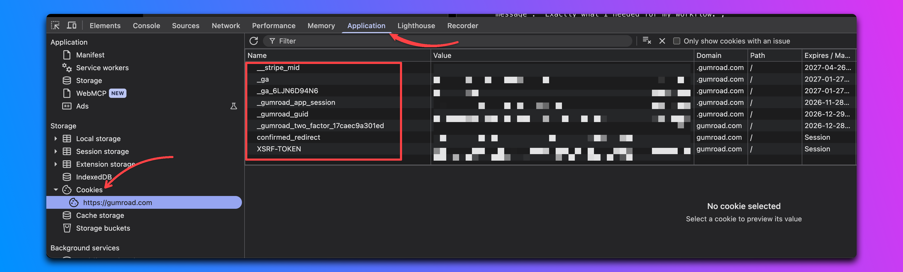

# gumroad-utils

A set of useful utils for dumping and and wiping your [gumroad.com](gumroad.com) library.

**Table of contents** (generated with [markdown-toc](http://ecotrust-canada.github.io/markdown-toc/))

- [Preface](#preface)
- [Installation](#installation)
- [Preparations](#preparations)
- [Usage](#usage)
  - [Package](#package)
  - [Command Line Tool](#command-line-tool)
- [License](#license)
- [Notes](#notes)

## Preface

This tool started out of desire to download products that don't provide "Download as ZIP" button.
Nothing more, nothing else.

## Installation

Download this repository either by [this link](archive/refs/heads/master.zip) or by simply cloning this repo:

```bash
git clone --depth 1 https://github.com/obsessedcake/gumroad-utils.git
```

Then install it with [uv](https://docs.astral.sh/uv/). Credentials are stored with [fnox](https://fnox.jdx.dev/); [mise](https://mise.jdx.dev/) installs the pinned `uv` and `fnox` from [mise.toml](mise.toml):

```bash
mise install
uv sync  # creates .venv and installs the package in editable mode
uv run gumroad-utils --help
```

Or install the `gumroad-utils` command globally:

```bash
uv tool install -e .
```

## Preparations

gumroad-utils signs in with the cookies of your logged-in browser session. Run the interactive setup:

```bash
gumroad-utils --setup
```

It opens [gumroad.com/library](https://gumroad.com/library) and walks you through copying each value from DevTools (`⌥⌘I` on macOS, `F12` elsewhere) > **Application** > **Cookies** > `https://gumroad.com`:



| Prompt | Where to find it | Required |
| --- | --- | --- |
| `_gumroad_app_session` | cookie value | yes |
| `_gumroad_guid` | cookie value | yes |
| `cf_clearance` | cookie value, only listed if Cloudflare challenged your browser | no |
| User agent | run `navigator.userAgent` in the DevTools **Console**, same browser as the cookies | yes |
| Purchase email | the email you bought products with, used for Gumroad's email confirmation flow | no |

Values go into your OS keychain (service `gumroad-utils`) via fnox; the fnox config at `~/.config/gumroad-utils/fnox.toml` only names them.
If you run `gumroad-utils` without stored credentials in a terminal, the setup starts automatically.

`_gumroad_app_session` and `cf_clearance` change quite often, so if downloads suddenly stop working, re-run `gumroad-utils --setup` and press Enter to keep the values that are still valid.

Environment variables `GUMROAD_APP_SESSION`, `GUMROAD_GUID`, `GUMROAD_USER_AGENT`, `GUMROAD_EMAIL` and `GUMROAD_CF_CLEARANCE` take precedence over the keychain, e.g. for `fnox exec` or CI.

### Product folder

You can customize product folder name with `--folder-template` (default: `{purchase_at:%Y.%m} {product_name} ({price})`) and the replacement for `/` in names with `--slash-replacement` (default: `-`).

The template follows the general rules of [`str.format()`](https://docs.python.org/3/library/string.html#format-string-syntax) ([PEP 3101](https://www.python.org/dev/peps/pep-3101/)).

Following values currently can be used in template:

- `purchase_at`: [datetime.date](https://docs.python.org/3/library/datetime.html#date-objects),
- `product_name`: [str](https://docs.python.org/3/library/stdtypes.html#text-sequence-type-str),
- `price`: [str](https://docs.python.org/3/library/stdtypes.html#text-sequence-type-str).

## Usage

This project is exposed in two ways: as a [package](#package) and as a [command line tool](#command-line-tool).

### Package

This project exposes a `gumroad_utils` package that exposes [gumroad.com](gumroad.com) API and can be used as shown below.

```python
from pathlib import Path

from gumroad_utils import FilesCache, GumroadScrapper, GumroadSession

session = GumroadSession(
    app_session="MyAppSession",
    guid="MyGuid",
    user_agent="MyUserAgent",
    email="my@email.com",
    cf_clearance="MyCfClearance",
)
files_cache = FilesCache(Path("gumroad.cache"))
scrapper = GumroadScrapper(
    session,
    files_cache,
    root_folder=Path.cwd(),
    product_folder_tmpl="{product_name}",
    slash_replacement="-",
    zip_archives=False,
)
for item in scrapper.fetch_library(creators={"nol3studio"}):
    scrapper.scrap_product_page(item.url)
```

It's also worth to mention that `GumroadScrapper` uses it's own logger instance.
Therefore if you want to configure it, you need to call [logging.basicConfig](https://docs.python.org/3/library/logging.html#logging.basicConfig) before making a new instance of the `GumroadScrapper` class.

### Command Line Tool

This project also exposes a `gumroad-utils` command.

Run it without links to open an interactive picker of your library:

```bash
gumroad-utils
gumroad-utils -o path/to/output/directory
gumroad-utils -k nol3studio        # only products by these creators (profile usernames)
```

| Key | Action |
| --- | --- |
| `↑` / `↓` | Move |
| `Space` | Select / unselect the product |
| `a` | Select / unselect every product currently shown |
| `/` | Filter by product, variant or creator (`Esc` or `Enter` returns to the table) |
| `Enter` | Download the selected products (or the highlighted one if nothing is selected) |
| `Esc` / `q` | Quit without downloading |

To print the library as a table instead, or to download all of it without picking:

```bash
gumroad-utils --list
gumroad-utils --all
gumroad-utils --all -k nol3studio
```

Without a terminal (e.g. piped output), `gumroad-utils` prints the table and downloads nothing.

To download specific products, pass their links (or `/d/` tokens), or a file with one link per line:

```bash
gumroad-utils https://app.gumroad.com/d/f0000000000000000000000000000000
gumroad-utils f0000000000000000000000000000000
gumroad-utils --links links.txt
```

By default every file is downloaded separately. With `--zip`, products that offer Gumroad's **Download all → Download as ZIP** are fetched as ZIP archives instead (one per product, or one per file group), when Gumroad has already built them; anything not covered by a ready archive is still downloaded file by file.

(`-o`, `--folder-template`, `--slash-replacement` and `--zip` work the same way everywhere. The download cache `gumroad.cache` is kept in the output directory.)


## TODO

- [ ] Improve caching.
- [ ] Implement automatic wiping of all library products.
- [ ] Implement payments statistic.

## License

All code is licensed under the [GPL-3.0](https://www.gnu.org/licenses/gpl-3.0.txt) license.

## Notes

This project currently scraps [gumroad.com](gumroad.com) directly without using their internal API.
It may not work tomorrow, it may not work in a month, [gumroad.com](gumroad.com) could break it at any moment.
It works now, though.

Taking into an account what has been said, please, be a decent person, don't re-scrape your library and bought products too much.
Using this tool once a day is probably a reasonable maximum.
Abuse of their site will likely lead to their reasonable reaction, and being able to programmatically fetch all your accounts data is too nice of a facility to lose to assholes abusing things.
